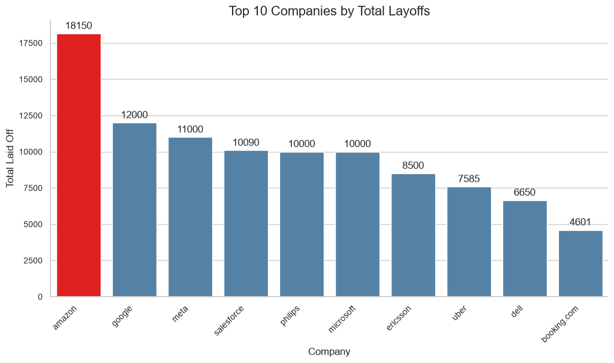
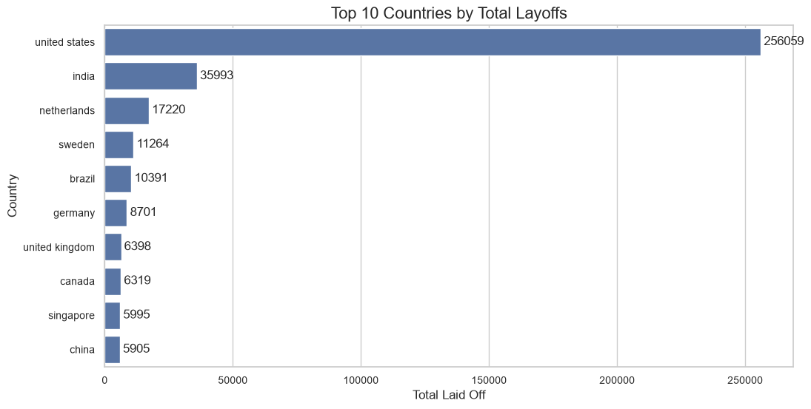
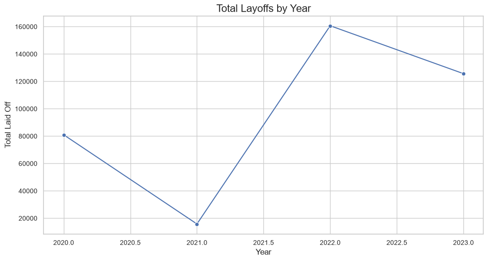
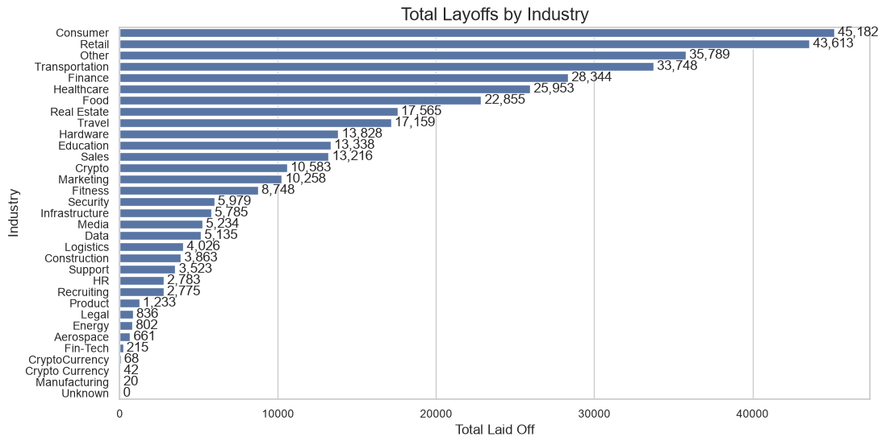
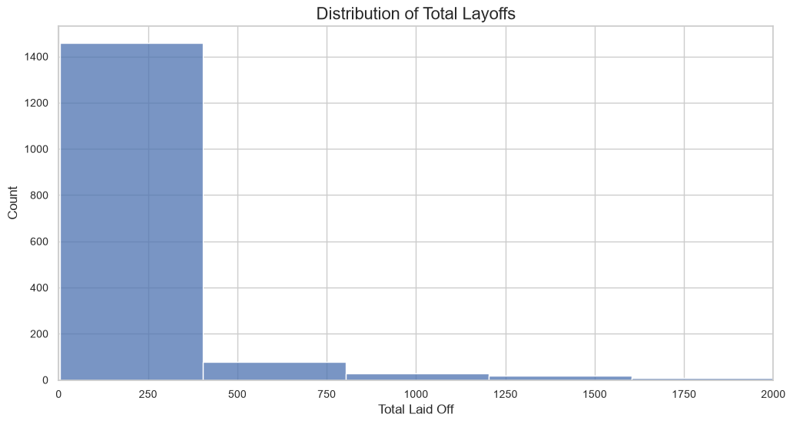
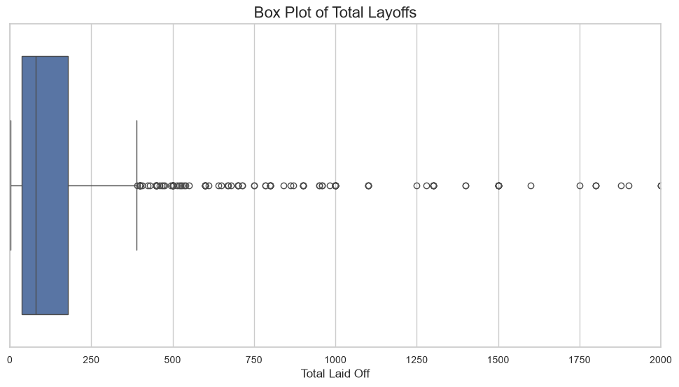
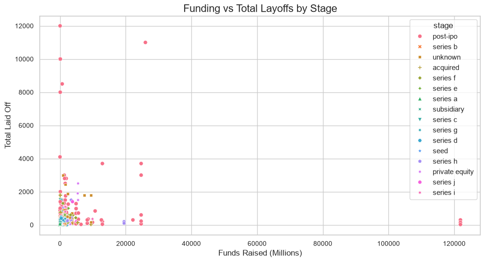
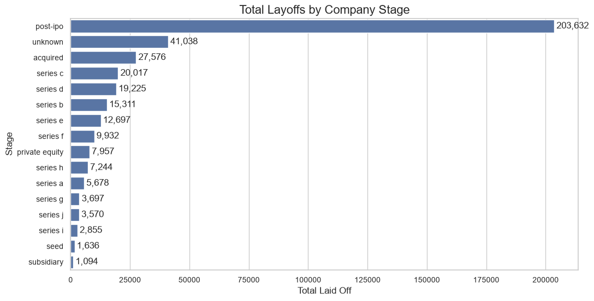
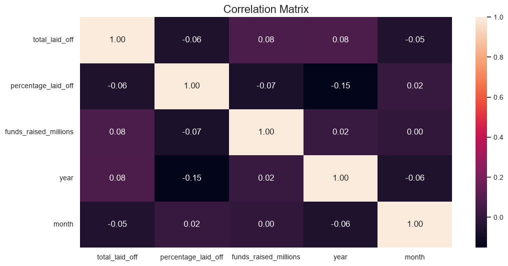

# Layoffs Data Analysis

## Project Overview

This project analyzes layoffs data to identify major patterns and trends in workforce reductions across companies, countries, industries, company stages, and years.

The project covers the main steps of a data analysis workflow, including data cleaning, exploratory data analysis (EDA), and data visualization using **Python**, in addition to building an interactive dashboard using **Power BI**.
The project is also published and version-controlled on **GitHub**.

## Dataset

The dataset contains information about layoffs across different companies and industries.

### Main Features

- Company
- Location
- Industry
- Total Laid Off
- Percentage Laid Off
- Date
- Stage
- Country
- Funds Raised (Millions)

The original dataset is included in this repository as `layoffs.csv`.

## Tools & Libraries

- Python
- Jupyter Notebook
- Pandas
- NumPy
- Matplotlib
- Seaborn
- Power BI (interactive dashboard)
- GitHub (version control and project hosting)

## Data Cleaning

The dataset was prepared for analysis by performing several data cleaning and validation steps, including:

- Handling missing values
- Standardizing categorical data
- Converting columns to appropriate data types
- Extracting year information from dates
- Checking data consistency and validity
- Preparing the dataset for exploratory analysis

## Exploratory Data Analysis

The analysis focused on understanding layoffs patterns from different perspectives.

The main questions explored were:

- Which companies recorded the highest number of layoffs?
- Which countries were most affected?
- Which industries experienced the highest layoffs?
- How did layoffs change over the years?
- Which company stages accounted for the largest share of layoffs?
- How are total layoffs distributed?
- Are there significant outliers in total layoffs?
- Is there a relationship between funding raised and total layoffs?
- How are the numerical variables correlated?

## Interactive Power BI Dashboard

In addition to the Python analysis, I built an interactive dashboard using **Power BI** to explore the layoffs data (2020-2023) in a more dynamic way.

### What the Dashboard Includes

- **Interactive Filters:** Year, Company, Country, Industry, and Stage slicers that update all visuals at once.
- **KPI Cards:** Total Laid Off (383K), Total Companies (1,884), Total Funds Raised, Average Layoff per Company (203), and Average Funds Raised (823).
- **Layoffs Trend Over Time:** A line/area chart showing how layoffs changed from 2020 to 2023.
- **Top 5 Countries by Total Laid Off:** A bar chart highlighting the most affected countries, led by the United States.
- **Top 5 Stages by Total Laid Off:** A bar chart comparing company stages, with Post-IPO companies at the top.
- **Companies by Total Laid Off:** A detailed table showing each company's layoffs, funds raised, industry, and country.
- **Top 10 Industries by Total Laid Off:** A bar chart showing the industries with the highest layoffs, such as Consumer and Retail.
- **Layoffs by Country:** A donut chart showing each country's share of total layoffs (the United States accounts for about 66.83%).

### Dashboard Link

🔗 **[Open the Interactive Layoffs Dashboard](https://app.powerbi.com/view?r=eyJrIjoiOTQ2MGM5NDItYzU1OS00YmRmLWFjMjYtMzJjOGQyNmE3NTFlIiwidCI6IjJiYjZlNWJjLWMxMDktNDdmYi05NDMzLWMxYzZmNGZhMzNmZiIsImMiOjl9)**

## Data Visualization

### 1. Top 10 Companies by Total Layoffs
This visualization shows the companies with the highest total number of layoffs in the dataset.

### 2. Top 10 Countries by Total Layoffs
This visualization shows the countries with the highest total number of layoffs.

### 3. Layoffs by Year
This visualization shows how total layoffs changed over the years.

### 4. Layoffs by Industry
This visualization highlights the industries with the highest number of layoffs.

### 5. Distribution of Total Layoffs
The histogram shows the distribution of total layoffs and highlights how most observations are concentrated at lower values.

### 6. Box Plot of Total Layoffs
The box plot helps identify the spread of total layoffs and the presence of significant outliers.

### 7. Funding vs Total Layoffs
This scatter plot explores the relationship between funds raised and total layoffs, while also comparing different company stages.

### 8. Layoffs by Company Stage
This visualization compares layoffs across different company stages.

### 9. Correlation Matrix
The correlation matrix shows the relationships between the numerical variables in the dataset.

## Key Insights

- Amazon recorded the highest total number of layoffs among the companies analyzed, with 18,150 employees laid off.

- The United States recorded the highest total number of layoffs among the countries in the dataset, with approximately 256,474 employees affected.

- The Consumer and Retail industries recorded some of the highest total numbers of layoffs, indicating that workforce reductions were particularly significant in these sectors.

- 2022 recorded the highest total number of layoffs in the dataset, with 161,711 employees affected, accounting for approximately 41.9% of all recorded layoffs.

- Post-IPO companies accounted for the largest share of total layoffs, with 204,882 employees affected. This indicates that large-scale layoffs were not limited to early-stage startups.

- The distribution of total layoffs is highly right-skewed. Most companies experienced relatively small workforce reductions, while a small number of companies recorded exceptionally large layoffs.

- The total layoffs variable contains several significant outliers, mainly caused by companies that conducted exceptionally large workforce reductions.

- There is a very weak linear relationship between funds raised and total layoffs, suggesting that the amount of funding raised alone is not a strong indicator of future workforce reductions.

## Recommendations

- Companies should regularly evaluate workforce size against business demand and operational needs to reduce the risk of large-scale layoffs.

- Companies should maintain appropriate financial reserves and carefully manage expenses to better handle periods of economic uncertainty.

- Business leaders and investors should closely monitor industries with high levels of layoffs and investigate the factors contributing to workforce reductions.

- Companies should not rely on funding size alone as an indicator of workforce stability. Funding should be supported by sustainable growth and effective financial planning.

- Organizations should continuously monitor workforce, financial, and operational metrics to identify potential risks early and support data-driven decision making.

## Conclusion

This project analyzed layoffs data to identify major patterns across companies, countries, industries, company stages, and years.

The analysis showed that layoffs were concentrated in a relatively small number of companies and that 2022 experienced a particularly high level of workforce reductions. The data also showed a weak linear relationship between funding raised and total layoffs.

Overall, the project demonstrates how data cleaning, exploratory data analysis, and visualization, using both Python and Power BI, can be used to identify meaningful patterns and support data-driven business decisions.
